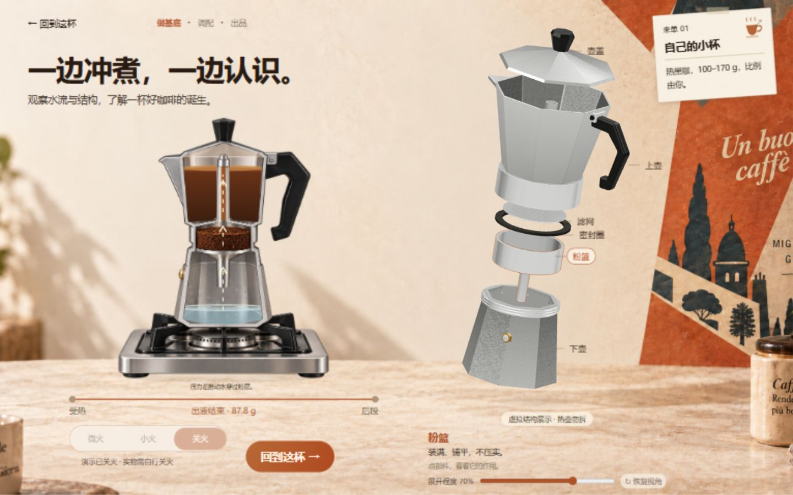
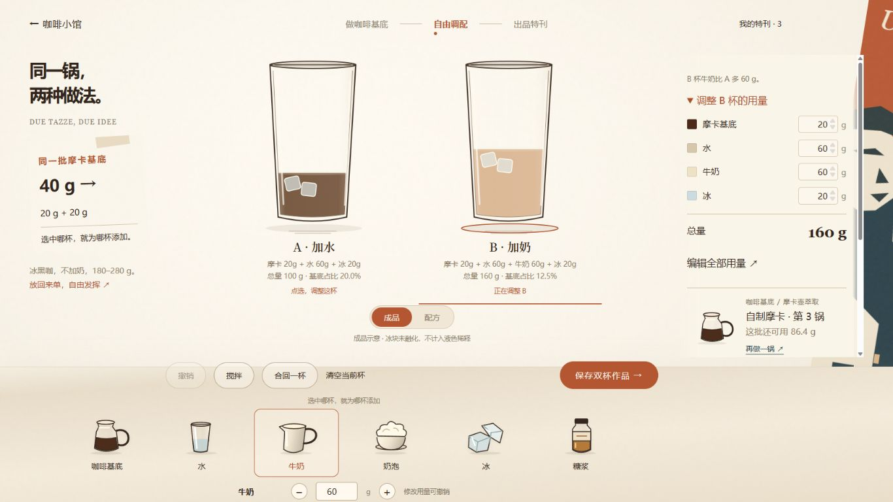

# CaffeSimulation · 咖啡小馆

**先做咖啡基底，再调出自己的配方。**

在意式海报风格的小馆里接一张随机来单，或自由创作。选摩卡壶后，用二维剖面决定水位与装粉；冲煮时，一边观察出液，一边查看实时三维的六组件拆解。收取的咖啡液进入有限库存，再加水、奶、奶泡、冰或糖浆，也能分杯比较，最后生成记录实际配方的特刊。



## 当前流程

1. **来单 / 自由创作 → 器具选择。** 首页保留人物剪贴画、今日菜单和自由发挥纸片。
2. **准备一锅。** 加水与装粉是同一页的两个可回改标签。水位过高或过低不能开始，装粉不压实；放篮、清理壶缘、旋合和移壶自动演示。
3. **冲煮与认识结构并行。** 左侧二维剖面显示水位、粉层、中央管和出液，右侧三维模型沿共同装配轴展开。查看部件不会暂停冲煮，也不要求读完知识才能收取。可调火力、提前关火收取。
4. **自由调配。** 实际收取的咖啡分为杯中用量和剩余库存。液体可按住或输入克数添加，冰每次投入一块 15 g；撤销、清空、搅拌和改名可回改。液体随容器倾角倒入，搅拌逐渐交叠并融合色带，冰块保留为固体。
5. **两杯对照。** 分杯守恒，A/B 各自修改；可以合回一杯、撤销，或再做一锅。换基底不会改动其他原料。
6. **出品特刊。** 杯子特写、人物拼贴、配方报道三种构图与六种配色，导出 1200 × 1800 PNG，或保存在当前浏览器的特刊册里。




主页面适配 1366×768 和 844×390 等横屏尺寸，主操作不需要上下滚页；长制作记录在说明区按需展开。竖屏分区排列并允许自然滚动。支持键盘操作、减少动画偏好与失焦停止连续添加。

## 模型与科学边界

新模型由项目原创 Blender 场景改造为六组独立 GLB 部件，上壶比下壶更宽；滤网使用实际通孔，金属连接处保留径向间隙，密封圈与座面对应。网页采用实时金属、抛光铝、胶木、橡胶和黄铜材质，以及柔和的环境反射光。二维剖面的半径与轴向高度共用模型参数。

这是教学几何与加速过程，没有按某一实物型号测量或校准。水位以实物安全阀及说明为准；虚拟演示结束会关火，真实器具需要自行关火。成品颜色、液位、泡沫和冰占用是视觉近似；配方色带表示质量比例，不宣称真实分层，也不能预测 TDS、温度、压力或风味。尚未进行真人学习效果测试。

[本次实现与验收记录](docs/hybrid-workbench-2026-10-09.md) · [素材来源](ASSET_PROVENANCE.md) · [历史项目记录](docs/project-history.md)

## 本地运行

没有依赖安装或构建步骤，本地 Three.js 随仓库提供。

```sh
node serve.cjs
```

打开 **http://127.0.0.1:4186/studio.html**；Windows 可使用 `./start.ps1`。服务仅监听本机；特刊 PNG 导出到 `exports/`，配方与制作进度保存在当前浏览器。

```sh
npm test
```

十二组测试涵盖准备依赖、热状态、出液守恒、桥接幂等性、配方编辑与库存、分杯 / 合杯 / 撤销、完整冰块投入，以及二维与三维尺寸、密封座、金属间隙和爆炸间距。浏览器验收另核对当前页面的实际操作与布局。

## 单文件 HTML

[single-html 分支](https://github.com/404-NOT-FOUND-ERROR/CaffeSimulation/tree/single-html) 提供内嵌图片、三维模型、Three.js 和所有页面脚本的 `index.html`。整条流程在一份 HTML 内切换，PNG 在浏览器中生成并下载，无需后台导出接口。

源码版可重新打包：

```sh
npm install
npm run build:single
node qa/single-html-test.mjs
```

输出 `dist/caffe-simulation.html`，约 40 MiB。网站本身仍无需安装依赖；esbuild 只用于制作单文件包。详细使用方式、验证记录与浏览器限制见 [单文件说明](docs/single-html.md)。

## 文件

| 文件 | 用途 |
| --- | --- |
| `studio.html`、`studio-*.js/css` | 首页、随机来单、自由创作和器具选择 |
| `moka-brew.html`、`hybrid-workbench.js/css` | 准备、冲煮和结构科普合并工作台 |
| `hybrid-moka-viewer.mjs`、`assets/hybrid/` | 六组件实时模型、材质、光照和装配参数 |
| `moka-diagram.mjs` | 与模型共用轮廓的二维操作剖面 |
| `moka.html`、`recipe-*.js/mjs/css`、`coffee-fidelity.css` | 调配、搅拌、双杯对照和特刊 |
| `work/build_hybrid_moka.py`、`work/hybrid-moka-v1.blend` | 可重建、可编辑的新版模型 |
| `moka-legacy.html`、`assets/poster-workbench/` | 保留的原固定相机摩卡操作台 |
| `qa/`、`docs/` | 状态测试、实际截图和设计记录 |

新模型重建需要 Blender 4.5；网站运行不需要 Blender。手冲与意式咖啡机目前保留历史原型，本次完整体验围绕摩卡壶。

代码采用 [MIT 许可](LICENSE)，软件许可不代替用户提供模型及其他素材各自的权利。
