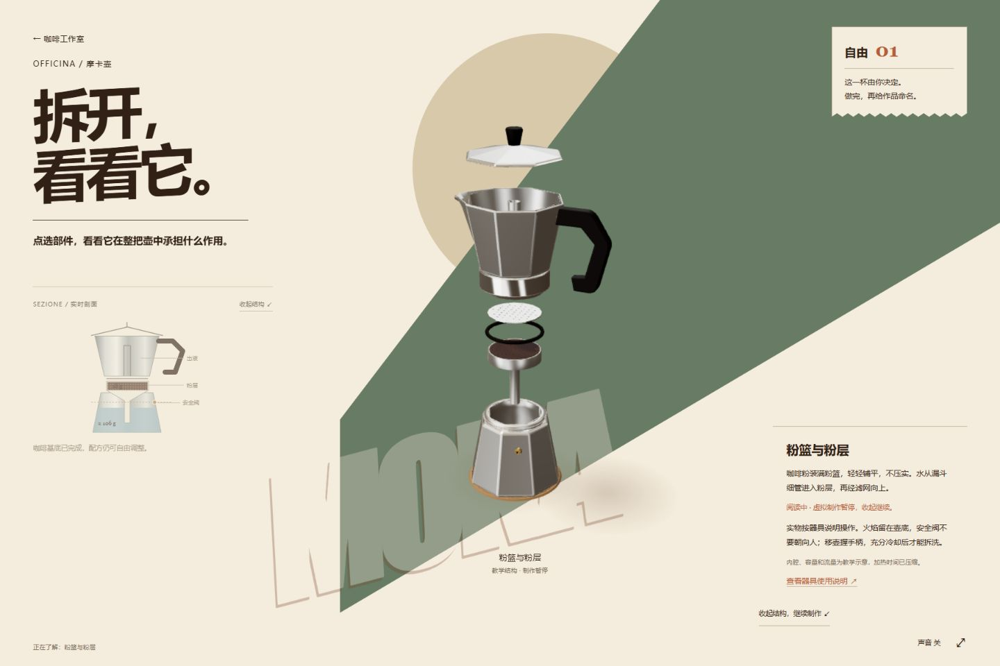
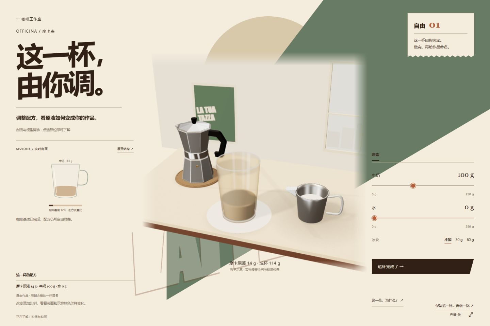
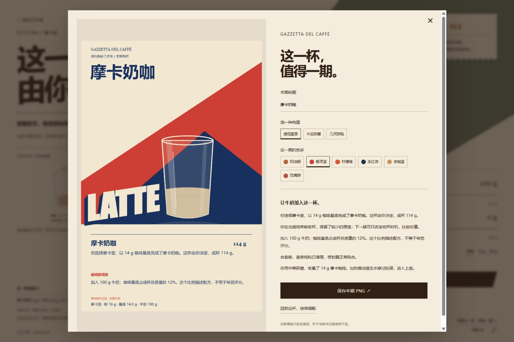

# CaffeSimulation · 咖啡小馆

[](https://github.com/404-NOT-FOUND-ERROR/CaffeSimulation/actions/workflows/checks.yml)

**把生活里的咖啡器具，变成可以探索的互动科普。**

接一张今日来单，或自由发挥；选择器具，准备、冲煮、调饮，再让自己的咖啡登上一期意式海报特刊。CaffeSimulation 面向普通成年人、青少年及学生，将器具结构、操作选择和成杯结果串成一段可玩的 HTML 体验。当前重点完善摩卡壶这条线。

An Italian poster inspired interactive coffee science studio: take an order or create freely, explore a Moka pot in 3D, brew and mix a drink, then create a recipe-based coffee gazette.


> 以上及下方截图均来自当前可运行页面。设计概念图另列在文档中。

## 怎样玩

1. **挑一张来单，或自由创作。** 今日菜单可以换一批，订单给出器具、杯量与配方要求。
2. **选器具。** 摩卡壶进入实时操作场景；手冲与意式咖啡机目前接入早期原型。
3. **准备与观察。** 在剖面上调水位、装粉并选择研磨，器具连续演示合壶和移炉。相关部位可以点开了解，也可以随时展开结构，收起继续制作。
4. **控制火候和收杯时机。** 观察水路与出液，调小火或提前关火，再由器具演示移壶、搅匀和倾倒。热表面提示跟随当前状态。
5. **调成自己的咖啡。** 牛奶、水和冰的量可以回改，杯中颜色、液面和配方同步更新。
6. **生成本期特刊。** 报道依据实际制作记录生成；3 种构图、6 种配色、标题与构图编辑，导出 1200 × 1800 PNG。改海报风格时，饮品和配方保持不变。

了解原理与制作发生在同一个场景：点选当前部位查看短说明，需要时展开结构；阅读期间暂停虚拟制作，返回保留进度和配方。

## 实际页面

| 结构拆解与科普 | 调饮与成杯 |
| --- | --- |
|  |  |
| 点选组件查看作用，部件沿装配轴展开。 | 基底、牛奶、水与冰分别记录，调配可以回改。 |



[查看完整图集：器具选择、结构、调饮、特刊与手机操作](docs/gallery.md)

## 这是一种怎样的科普体验

- **先有制作动机。** 来单与自由创作决定这杯的方向，器具知识伴随使用出现。
- **选择产生可观察的变化。** 水位、研磨、火力、收杯时机和调饮比例进入制作记录；重复一锅时可以比较基底份量。
- **结构帮助解释操作。** 3D 拆解与 SVG 剖面对应器具部件、水位、粉层和出液路径。
- **用作品承接反馈。** 特刊记录这一杯怎么做、改过什么，兼顾成杯展示与知识回顾。
- **延续意式海报的视觉语言。** 人物剪贴画、倾斜大字、纸片菜单与暖色吧台形成入口；制作场景保留同一设计语言，分享特刊可以独立变换配色与构图。

## 当前完成度

主要体验是摩卡壶，手冲与意式仍是早期原型。三维外壳已细化，教学内部件与实时材质、光影仍需继续核验和改善。

容量、内腔与流量采用未实测校准的教学示意，加热时间经过压缩；配方颜色及数据不能预测真实风味。清洗目前通过随手说明提供，尚未实现完整操作动画。实物操作以对应器具说明为准。

[完整流程审核与已知边界](docs/workbench-flow-audit-2026-10-05.md) · [三场景设计概念](docs/workbench-three-scenes-prompt.md) · [历史开发记录](docs/project-history.md)

## 本地运行

使用 Node.js，自动检查环境为 Node 24。网页没有安装依赖或构建步骤，Three.js 已随仓库提供。

```sh
node serve.cjs
```

打开 **http://127.0.0.1:4186/**。Windows 也可执行 `./start.ps1`。服务只监听本机；当前未配置公共体验网址。

```sh
npm test
```

七组测试验证准备依赖、运动路径、材料与出液守恒、热状态、回读、配方编辑及报道事实。GitHub Actions 在推送与拉取请求时执行测试和脚本语法检查。

仅浏览静态页面无需服务端。本地服务还支持将特刊保存到 `exports/` 并提供 PNG 链接；成杯记录保存在当前浏览器里。

## 项目结构

| 路径 | 用途 |
| --- | --- |
| `studio.html`、`studio-*.js/css` | 小馆首页、来单、器具选择与早期其他器具体验 |
| `moka.html`、`workshop-*.js/mjs/css` | 摩卡状态、交互、SVG 剖面与 Three.js 场景 |
| `assets/`、`vendor/` | 发布素材、GLB 模型和本地 Three.js |
| `work/` | 可编辑 Blender 场景与制作脚本 |
| `qa/`、`docs/` | 测试、实际截图、设计和核验记录 |

运行网站只需仓库中的发布资产。重新渲染部分展示素材还需要用户提供的原始模型。

代码沿用仓库已有的 [MIT 许可](LICENSE)。第三方库与模型素材的来源和范围见 [素材说明](ASSET_PROVENANCE.md)。
