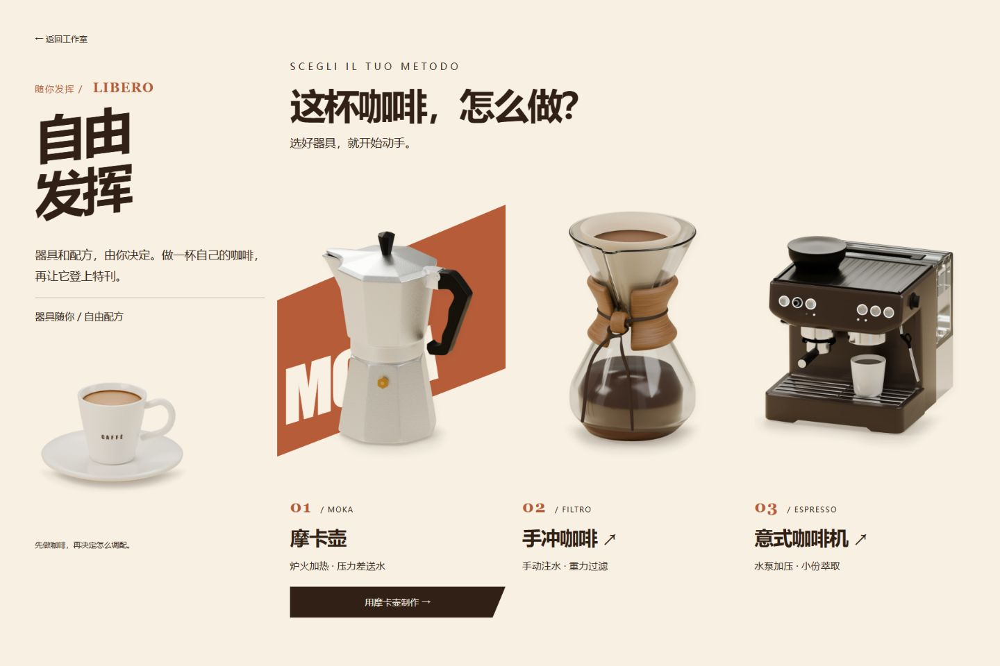
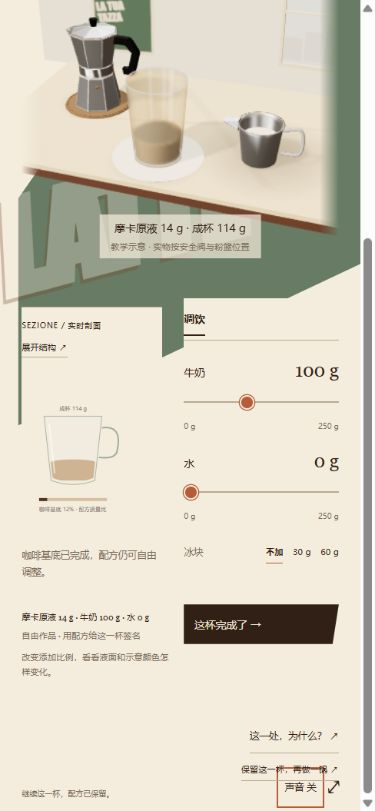

# 咖啡小馆 · 实际页面图集

2026-10-05 采集。桌面截图为 1440 × 960，手机截图为 375 × 811。截图来自实际浏览器页面，全部保存在本仓库的 `docs/screenshots/` 中；模型、按钮、说明和特刊都属于当前可运行原型。

[返回项目介绍](../README.md)

## 01 · 今日菜单与自由发挥

意式海报风格的小馆入口。随机来单给出这杯的目标，也可以直接选择自由发挥。菜单纸片与便签是可操作的 HTML 元素。

## 02 · 选择冲煮器具

展示器具的形态与简短原理。选择摩卡壶后直接进入操作场景，手冲和意式当前接入早期原型。

## 03 · 拆开看结构

摩卡壶沿装配轴展开。左侧剖面与部件说明帮助理解粉篮、滤网、密封圈与水路。截图选中了粉篮；结构界面暂停虚拟制作，收起继续。

## 04 · 调成自己的咖啡

咖啡已经进入杯子，牛奶、水与冰可以分别修改。截图展示前一轮提前收杯得到的约 14 g 咖啡基底，加 100 g 奶后的约 114 g 作品，是一次教学实验记录，不是通用推荐配方。

## 05 · 让作品登上特刊

特刊解释实际收杯和调配过程，并支持不同构图、配色与标题。同一杯改海报时，配方保持不变；可导出 PNG。

## 06 · 手机调饮操作区

手机页面采用纵向布局。此图滚动到操作区，展示剖面、配方和控制的分区排列。

## 关于设计参考

[三场景概念与提示词](workbench-three-scenes-prompt.md) 单独作为设计参考保存。实时材质、光影和教学结构的完成程度见 [流程审核](workbench-flow-audit-2026-10-05.md)。
