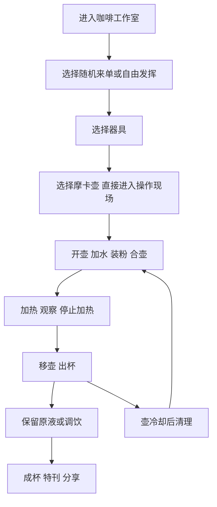

# 摩卡壶互动科普体验设计

设计稿日期：2026年10月4日。

本稿保存摩卡壶下一版互动 HTML 的整体逻辑，供内容、模型、界面和程序制作共同使用。已确认的顺序是：进入咖啡工作室，选择随机来单或自由发挥，再选择器具；选择摩卡壶后直接进入操作现场。教学伴随具体操作，结构说明按需展开，警告跟随器具状态；制作结果形成可调饮、可分享的意式特刊。先把摩卡壶做好，再扩展其他器具。设计以合理、精简为原则，不把伴随功能另做成前置入口或用户模式。以下手势、镜头与模拟细节是拟议设计，需要通过原型验证。

## 体验目标

用户来到一个具有意式咖啡文化气息的工作室，亲手用一把摩卡壶制作咖啡。镜头引导注意力，用户控制动作，器具变化给出反馈，知识解释帮助理解原因。

首次使用的人应能认识主要部件及其用途，完成准备、加热、移壶和出杯，识别操作风险，知道冷却后怎样收拾。想来玩的人可以接单、自由制作、调整做法和调饮，得到与制作记录对应的作品。愿意深入的人可以随时进入局部原理、完整结构和对照观察。

第一版以一款结构、容量与说明书明确的经典摩卡壶为教学对象。具体型号、正常装水量与粉篮容量仍待核验。教学从已按说明书启用、正常可用的器具开始；新壶首次启用的处理另放在器具资料中。现有原型中的固定粉量、可任意调节的装水范围，不能直接成为新手教学标准。

## 开始制作与伴随教学

用户先在咖啡工作室从随机来单中选择一张，或选择自由发挥；随后选择器具。选择摩卡壶后，带着已有的制作目标直接进入可操作的场景，不再增加一轮学习方式选择。

同一套操作照顾不同用户。拿起水壶时，镜头靠近下壶，壶口附近出现一句加水提示；取出粉篮时，就地说明它的名称和用途；准备合壶时，相关位置提示检查壶缘。首次使用者边动手边认识部件，熟悉的人可以继续自己的操作，无需先读说明或完成器具导览。

进一步的原理和结构由当前对象的说明按需展开，关闭后继续原动作。教学不另设起点，不要求用户选择熟练程度，也不把每种说明都列成一个菜单。风险提示在相关操作发生时出现，不依赖用户是否阅读过科普。

## 来单与器具的衔接

以下是供审核的拟议细节。工作室一次展示少量随机来单，用户选一张或自由发挥；来单变化来自饮品需求和情境，避免只随机更换客人姓名。第一版可用早餐热奶咖、长杯黑咖、冰奶咖等摩卡壶可完成的需求，其他器具的完整体验留待后续扩展。

订单有一句人物需求和少量可核对的条件，例如“早餐想喝一杯小杯热奶咖，不加冰”。是否加奶、是否加冰、成杯份量与器具要求可以核对；“我喜欢浓郁”可以作为叙事情境，未验证的味觉模拟不能据此判定交单成功。各订单的具体份量范围需按第一版器具和杯子另定。

选择器具时，只在当前器具旁说明它能做什么，以及是否符合已选订单。摩卡壶被选中后，订单缩成工作台上的一张小单据，工具与材料留在场景中。自由发挥沿同样的制作操作开始，用户可以等调成杯后再命名，不另填一份创作表单。

订单是否满足与器具是否可安全操作分别判断。加错了奶可能让黑咖订单不匹配，但仍然形成可保存的奶咖作品；危险动作则在发生的位置受到限制。用户可以保留这杯，再为订单制作另一杯。

## 工作台与体验路径

HTML 以同一工作台的场景切换、镜头状态和局部面板组织内容。准备、冲煮、调饮和特刊可以形成不同视图，但器具、杯子和制作记录持续存在。用户的导航位置与器具能否执行某个动作分开判断。

图中表示制作所需的先后关系，不是必须逐页通关的课程。知识说明附着在当前对象与动作上，按需展开、随时收起，不形成另一条入场路径。用户可以回到来单、选择已做的杯子和制作特刊；加热开始后，修改原料需要先完成停止加热与冷却等操作，或明确开始一份新制作。

出杯后即开放调饮与特刊。冷却清理作为仍可继续的收尾过程，用户回到壶边时出现对应提醒；它不作为保存作品的前置关卡。加热过的壶仍保留受热状态，不能因进入调饮或海报界面而变成可拆开的冷壶。

## 模型上的操作与镜头

每个场景都要写清看哪里、做什么、模型怎样变化、何时完成，以及做错后如何恢复。默认动作应使用单指或单鼠标操作，给合理的落位容错；辅助操作和键盘替代输入执行同样的动作状态。

| 场景 | 镜头与用户动作 | 模型反馈与完成条件 | 当下可进入的科普 |
| --- | --- | --- | --- |
| 打开与检查 | 从完整壶缓慢靠近接缝。用户抓住冷壶对应部位，沿旋转方向拖动，旋开后取出粉篮。 | 上下壶沿装配关系分离；粉篮离开下壶后可放到工作台。用户能查看上壶底部。 | 下壶、粉篮、上壶各自做什么；滤网和密封圈在哪里。 |
| 加水 | 镜头转到能看到下壶开口与液面的俯视近景。用户拿起水壶，移动到壶口并倾倒。 | 水流、液面和倒入量同步变化；扶正停止。目标区域由所选器具的结构与说明书决定。过量后允许倒出多余水。 | 水位与内部空间的关系；安全阀的用途。 |
| 放粉篮与装粉 | 用户把粉篮放回下壶。镜头靠近粉篮，用户倒粉或用勺添加，再整理粉面和边缘。 | 粉面逐渐形成，残粉有可清理的位置；动作不能只改变旁边的数字。完成状态由所选粉篮的适当填充与边缘状态判断。 | 咖啡粉装在哪里；水怎样穿过粉层。 |
| 检查与合壶 | 用户查看上壶底部，将上壶对准下壶并旋转。镜头帮助看清接缝，不在拖动途中突然切换。 | 接近正确位置后有轻微吸附；旋转与轴向移动对应。用定性的落位反馈表达合好，不显示虚假的真实扭矩。 | 密封圈和滤网的作用；接缝为何需要正常配合。 |
| 放壶与开火 | 镜头拉回工作台。用户把壶放上炉头，操作炉火旋钮。 | 放置、火焰与器具受热状态随动作变化。开始前检查相应准备状态。 | 热量怎样进入下壶；为什么要关注火焰范围。 |
| 观察与判断 | 镜头先保持整壶，允许进入教学剖视查看内部。用户调整火力、听声音、看出液变化，并决定结束时机。 | 受热、出液与流动反馈一致。声音可关闭，关键信息同时有视觉表达。结束判断不能只依赖一条完成进度。 | 压力差与液态水的路线；粉层如何影响流动。 |
| 停止加热与出杯 | 镜头回到整壶和杯子。用户关火，利用手柄移壶，倾倒咖啡；需要时先按所选器具的使用方式完成出杯前整理。 | 咖啡从壶流向杯子，两边液量同步变化；实际倒入杯中的份量成为该杯记录，剩余液体仍在壶中。 | 出液、壶内收集量与杯中份量有什么区别。 |
| 调饮与呈现 | 镜头转到杯子。用户拿起水、奶或冰的工具添加，选择杯型与呈现方式。 | 添加量影响总量、液面、配方和示意外观；撤回操作恢复对应记录。用户也可以保持原液。 | 稀释和再次萃取的区别；咖啡基底与成杯配方的关系。 |
| 冷却与收拾 | 用户将壶放在合适的垫上，查看冷却状态；之后再拆开、处理粉渣和清理。 | 收尾需要相应器具状态。教学时间可加速，但应说明时间被压缩。完成后可开始新的原料准备。 | 受热状态为什么不会随关火立即消失；零件如何保养。 |

镜头用于交代位置、关系与动作，进入操作后保持稳定。用户旋转查看时，返回操作能恢复合适角度。已经熟悉的镜头允许跳过；减少动态效果设置可改为短淡入或直接切换。

选中对象用于聚焦镜头和说明，抓取、倾倒、旋转等才改变制作状态。镜头在操作前到位，连续拖动期间保持稳定。拖拽握持位置操作对象，拖拽场景空白处查看角度；当前对象用简洁的方向反馈说明允许的动作，避免同一次拖动既转镜头又拧壶。手势映射仍需原型验证。

完成动作由实际状态判断：水确实倒入、粉篮确实放好、上下壶确实合上，不靠点击“下一步”登记。完成后提示收起，相关工具出现轻微反馈；用户仍可检查与修正。粉篮也可先放在工作台上装粉再放回，不把推荐操作顺序写成额外通关限制。合壶后由用户把壶移到炉头，不能自动开始加热。

海报式倾斜构图保留在进入、结构展示和成杯等视图；所有拆解部件共享同一装配轴。实际制作的器具放置、水面与重力表达应一致，图形构图角度不能成为错误的使用示范。

## 加水场景的详细设计

加水作为第一段重点验证的操作，拟按以下顺序设计：

1. 下壶已打开并放稳。当前操作只需一句提示：“拿起水壶，给下壶加水”。指向水壶时，握持部位有轻微反馈；用户可以直接拿取。
2. 选中水壶时，镜头移动到能看清下壶开口的角度，再开始连续抓取与倾倒。下壶仍有足够上下文，用户知道自己正在操作哪件东西；镜头不会追着正在拖动的水壶转动。
3. 水壶接近壶口后轻微吸附在便于倾倒的位置，用户再沿短弧线拖动倾角。吸附只帮助对位，不代替倒水。水流随倾角变化，扶正停止；松手、取消或失去输入焦点也立即止流并扶正工具，保留已经倒入的水。具体手势由单手原型测试决定。
4. 液面上升，接近目标位置时才突出参考标记。小字读数辅助判断，结构和液面是主要反馈。
5. 装水过量时，在相关位置提示并提供倒出动作；完成纠正后恢复正常准备。用户无需整锅重置。
6. 用户可以点“这里为什么要留空间？”进入局部解释。返回后水壶位置、水量和当前动作保留。
7. 合适装水状态出现后，粉篮出现轻微的可操作反馈。用户可以继续检查和修正，不必点击一个完成按钮才能确认水已装入。

模型落位可以容错，水量判断不能因吸附而自动补到正确值。让用户亲手控制停止与修正，是这段操作需要验证的学习价值。

## 加热与出杯的具体判定

壶放上炉头后，用户旋转炉火旋钮开始加热。系统检查装水、粉篮、合壶和壶盖等必要条件；缺少条件时直接定位相应部位，让用户完成修正，不把人送回入口。第一版准备从冷壶和所选说明书规定的用水开始，热水预装等变化不作为默认教学操作。

加热时，同一场景持续显示受热、初次出液、收集量增加和流动变化。用户可以调火、查看局部原理、判断何时停止。实际壶盖保持关闭，出液由标注清楚的教学剖视呈现；打开观察视图不等于把正在加热的真实壶盖掀开。普通实时剖视继续显示过程，展开需要阅读的说明或爆炸结构时才暂停虚拟时间。

反馈包括出液开始的早晚、流量趋势、上壶收集量、声音与受热状态。第一版将真实等待压缩为可玩的演示时间，并明确标注；具体速度由原型节奏测试决定。结束的正常参考点与所选器具说明书对应，不能用一条进度条替代观察，也不以故意等到异常喷溅作为正常完成条件。

用户提前停止可能收集到较少咖啡，但只要有实际咖啡就可以出杯；并非只有标准结果才允许继续。关火后的余热与残余出液保留，在移壶、放到合适垫面后继续按模型变化，不瞬间清空热状态。异常持续加热先提示停止，必要时限制危险操作；不把故障当成随机娱乐奖励。

用户通过相应握持部位移壶，停止加热后按所选说明书完成出杯前操作。以当前参考的 Moka Express 为例，结束出液后先在上壶中搅匀，再倒入杯中。杯前的倾倒同样由用户控制，松手止流；上壶减少量与杯中实际得到的咖啡同步，剩余咖啡仍可分给另一杯。

## 操作中的结构科普

使用一套随对象出现的说明：点模型上的部件，就地看到名称、一句用途和必要的动作示意；需要知道原因时，在这条说明中继续展开。加水解释水位，合壶解释密封，加热解释水路和压力差，内容跟随用户正在关注的对象。

局部说明中可以进一步展开整壶结构，用旋转、拆解和水路动画理解部件关系。由浅到深的内容在同一说明中展开，不列成三个并排入口，也不新增必须先完成的认识环节。收起后回到原操作位置；是否深入完全由用户决定。

深入阅读或完整结构观察前，保存现场并暂停虚拟时间；返回时恢复镜头、原料、工具、装配和冲煮状态。浅层提示以就地说明为主，若用户展开阅读内容，也应提供明确的暂停状态。教学暂停不表示真实炉火已经被用户关闭。

热壶的拆解、透明和剖面是标注清楚的教学观察视图，使用独立展示状态，不改变正在制作的那把壶。用户操作热壶旋开时，仍按警告规则处理。观察视图中的压力、路径与受热区域，应说明哪些是示意。

基础原理采用“加热使下壶气体压力变化，压力差推动液态水进入细管并穿过粉层”的表达。进一步解释空气和水蒸气的贡献时，应与选用的科学模型对应，避免把水路画成仅有蒸汽穿过咖啡粉。物理解释参考 [维也纳大学摩卡物理教学项目](https://compphys.univie.ac.at/Moka/)与 [Warren D. King 的摩卡物理研究](https://doi.org/10.1119/1.2870524)，具体数值模型需另行核验；研究中的实验操作不替代选定器具的使用规范。

## 警告与纠错

使用规范先参照 [Bialetti Moka Express 官方说明书](https://www.bialetti.com/media/manual/caffettiere/MOKA_EXPRESS-manual.pdf)，最终与选定器具对应。已核对的基准包括：按说明书装水至安全阀下缘，咖啡粉不压实并清理壶缘，合壶不借手柄发力，火焰不超出底部，使用中保持壶盖关闭，热表面用相应握持部位操作，冷却后再拆开，热壶放在合适表面。以下是据此拟议的界面反馈，具体判定阈值需要模型核验。

| 尝试或异常 | 拟议反馈 | 用户的恢复动作 |
| --- | --- | --- |
| 水位超过所选器具的要求 | 在液面附近提示，标明参考位置。 | 倒出多余水，保留其他准备。 |
| 残粉留在壶缘 | 指出具体位置，不替用户自动清掉。 | 用工具清理后再合壶。 |
| 尝试压实粉篮中的咖啡粉 | 中止压实动作，提供相关用途解释。 | 回到整理粉面的动作。 |
| 上壶没有对准或关键部件状态不对 | 接缝或对应部位给出反馈，指出需要检查的对象。 | 在允许的器具状态下重新放置、检查或更换教学部件。 |
| 试图在未准备好的情况下加热 | 提示当前缺少的条件，并定位相应位置。 | 回到该部位准备，而非从入口重来。 |
| 炉火超出适合范围 | 在炉火与壶底处提示，热风险与器具状态关联。 | 调整旋钮。 |
| 加热后尝试抓金属壶身 | 中止该抓取动作，局部提示“壶身很烫”，突出手柄位置。 | 改用对应握持操作。 |
| 热壶仍未冷却，尝试旋开 | 保留关闭状态并解释当前限制。 | 先完成停止加热、放置与等待冷却。 |
| 出现异常排放、接缝异常等教学故障 | 引导先停止加热；在独立观察视图解释，不让用户继续加火测试。 | 冷却后检查；需要专业处理的情况给出使用边界。 |

警告跟随器具与操作状态，在接单和自由发挥中一致。普通错误给修正空间，关键风险中止对应动作。纠正后能继续当前制作，不通过扣分、惊吓画面或整锅清零惩罚用户。

温度和压力未校准前，优先显示“正在受热”“壶身很烫”“冷却中”等教学状态。演示计时不能作为真实壶已可安全触碰的倒计时；手柄也不能被画成永远不会受热的部位。

## 制作的选择与结果区别

来单围绕摩卡壶能完成的饮品，例如原液黑咖、加水长杯、早餐奶咖、冰摩卡。同一来单允许用户在合适范围内尝试不同做法；订单匹配以可观测的器具、配方与成杯要求为依据。

正常操作的水位与粉篮填充按选定器具确定。第一版的发挥空间主要放在适合该器具的研磨选择、加热与收杯操作、实际倒入杯中的份量，以及后续加水、加奶和加冰。学习者修改准备参数时，需要有相应的重新准备动作。

要出现能感知的结果区别：制作中的出液起始、流动趋势和累计量有变化；成杯的份量、配方、液面与示意外观相对应；报道能指出用户何时停止、怎样调配、是否纠正过问题。真实风味不能由未验证的参数直接判定为好喝、苦或酸，也不生成伪精确的口感分数。

同一锅可以倒出不止一杯；记录需要区分锅内收集、尚在壶中的液体和已倒入某杯的份量。某杯继续调饮、另做一锅和查看上次作品，都要有明确对象，避免旧原液或旧准备状态被重复当成新的制作。

完成第一杯后，可以选择“再试一次，只改一件事”。对照采用同一器具与可对应的原料条件，比较某项做法的变化；对照、异常观察与制作共用工作台，不增加一套必须先通过的课程。

## 调饮与反馈的具体逻辑

杯子来到操作中心，水、奶和冰是可拿取的工具或材料。用户决定保留原液、添加什么、添加多少以及何时停止；添加量同步改变配方记录、液面和示意色泽。冰具有占位和融化状态，不能把冰块数量直接当成已经融入的等量水。热饮、冰饮的教学状态需要相应的混合模型，模型未校准前不给虚假的精确成杯温度。

咖啡基底的份量、奶水冰的添加与杯型共同造成可见的成杯区别。奶泡和分层若要展示，需要相应的制作动作与物理条件；不能换一个饮品名字就自动生成漂亮的拿铁泡沫。第一版先做可靠的混合与杯中表现，调饮工具在杯子附近就地使用，不增加调饮类型选择页。

用户认为这杯完成时，才明确提交来单或保存作品。配方操作仍可撤回或继续修改；出片后的版本是保存快照，新修改不改写旧作品。反馈只核对订单列出的条件，并引用实际发生的操作：例如符合加奶要求但误加了冰，指出这一项即可，既不整杯清零，也不自动把冰或奶移除。

特刊使用同一套可核对的内容生成简短报道，拟采用以下表达：

| 记录 | 可以形成的反馈 | 需要避免的表达 |
| --- | --- | --- |
| 杯中基底与奶的实际份量 | 这杯用了多少咖啡与奶，配方如何组成。 | 未经验证就断言浓郁度、甜度或好喝程度。 |
| 实际开始出液与停止时间 | 用户如何观察过程，何时结束，收集了多少咖啡。 | 给未校准模型的萃取打精确口感分数。 |
| 实际修正过量装水或残粉 | 指出用户完成的具体修正，以及它对应的结构知识。 | 看过提示便宣称用户已经理解或纠正。 |
| 订单要求与成杯记录 | 哪些要求已满足，哪项需要另一杯或进一步调整。 | 为了交单成功，静默修改配方与杯中液体。 |

报道以作品和具体发现为主，附一两条与本次相关的咖啡文化或器具知识；文化内容与作品直接相关，不另开一门必须阅读的课程。第一版饮品命名使用摩卡基底对应的名称，不把摩卡作品直接改名为意式浓缩，也不凭空出现未制作的奶泡。

## 成杯与特刊

出杯后可以保持原液，也可以亲手调配。杯型、添加量和液面变化使结果可见。命名使用与摩卡基底对应的饮品名称，例如摩卡黑咖、加水摩卡、摩卡奶咖和冰摩卡。

本期特刊既是可分享的作品，也是一份简短报道。内容从实际制作记录生成：器具与配方、成杯份量、操作选择、调饮方式、订单要求，以及可选择展示的发现。是否查看过知识入口与是否完成动作分别记录；点击说明不等同于已经学会，看到警告也不等同于已经完成纠正。

报道可以说“你发现壶身仍处于受热状态，改用手柄完成移壶”，前提是这些操作确实发生并记录。未观察到的行为不能写入报道。失败尝试也可以保存，反馈说明可继续调整的条件。

特刊提供多种意式广告海报构图、插画表达和独立配色，保留参考照片中的丰富性。实验界面的奶油、铜与咖啡色不限制海报配色。切换风格只改变表现方式，实际饮品、配方和制作事实保持不变。先保存杯子与报道快照，再进行换版式、调标题和出片，避免后续操作改写已经导出的作品。

清理不阻拦出片。完成作品后仍可以回工作台收拾，也可以保留这一杯、再做一锅或尝试另一张来单。

## 界面与实现要求

界面延续意式广告海报的字体层级、几何色块、银色摩卡壶和足够留白。模型与当前操作是视觉中心；提示与工具尽量靠近相关位置，当前对象的说明位置保持稳定，深入内容在该说明中展开。只呈现当前需要的控制，不增加前置选择或多排功能入口。移动端重新安排模型与工具，避免操作反馈与控制区隔得太远。

模型至少需要独立可操作的上下壶、粉篮、滤网、密封圈、壶盖、手柄与安全阀位置，并具有正确的内部空间、装配位置、旋转轴和点击区域。水壶、装粉工具、清理工具、炉头、垫与杯子也需要相应操作资产。现有银色外观与内部教学件可以作为起点，继续核验和补足，不能直接视为真实内部 CAD。

第一版可采用 Three.js 模型操作、预设镜头插值、有限的拖动约束、体积驱动的水面、可变化的粉面、路径水流与空间声音。局部科普用清晰的几何剖面或 SVG。每粒咖啡粉与每滴水不必独立进行物理计算，重点是用户动作、器具状态和显示结果一致。

### 技术实现与审核图的效果边界

2026年10月4日核查了当前代码。`studio.js` 使用 `moka-asset.js` 加载细化后的 GLB；模型已有分组、零件点击、拆解位移、银色环境反射与水/粉/咖啡内容变化。连续拖动目前主要旋转整壶，准备仍通过按住按钮或工具拖放推进；调饮由添加按钮修改记录，杯子使用 `studio-art.js` 中的 SVG。这些是可复用的基础，不能据此宣称审核图中的运镜、倾倒和直接组装已经实现。

下一版将输入命中的对象、当前动作与制作数据连接起来。先选中对象并完成聚焦运镜，再进入受约束的抓取、对位、旋转或倾倒；操作时锁定镜头拖动。动作必须可连续控制、随时停止与局部修正，不能用自动播放的演示替代用户操作。

| 场景 | 首版拟采用的实现 | 可以预期的效果 | 审核图需要收敛的部分 |
| --- | --- | --- | --- |
| 运镜与握持 | 给工作台、壶口、粉篮、炉头和杯子设置镜头位置与目标点，用插值切换；零件使用独立点击区域。 | 靠近时看清要操作的位置，开始拖动后视角稳定；提示跟随对象。 | 不承诺任意运镜都保持广告摄影级构图；操作期间不追着鼠标移动镜头。 |
| 开壶与合壶 | 上壶及其正常附属件组成一组；拖动映射为固定轴上的旋转与轴向位移，到位后吸附。 | 旋转逐步改变装配，合好有明确反馈，松手保留进度。 | 不以真实螺纹摩擦、任意碰撞或细微手劲作为首版机制。 |
| 加水与出杯 | 工具接近目标后吸附到便于操作的位置；倾角驱动流量。水流由有起点、落点的窄曲线网格表现，接收量驱动内部液面；出杯同步减少壶内存量。 | 拖动改变倾角和流量，松手停止，液量保持一致；倒多后可修正。 | 收敛图中的复杂折射、飞溅和随机水流分叉；水流不能作为固定播放、与实际倾角无关的视频。 |
| 装粉与整理 | 粉篮填充几何的高度随加入量变化，表面使用细纹理与少量实例颗粒；壶缘残粉用有限的可清理位置表示。 | 看得见粉面变化，也能清理具体残粉；粉量不只在旁边的数字中变化。 | 不逐粒计算碰撞或模拟任意堆积。 |
| 加热与剖视 | 加热状态与简化出液模型驱动水量、上壶收集量、声音和水路动画；剖视优先制作一份结构核验后的截面几何，配合局部裁切。 | 壶盖关闭时也能理解内部路线，调火与停止影响过程；深入说明暂停后可恢复。 | 不把生图剖面直接当内部 CAD；材质裁切本身不自动生成正确的壁厚与封口，需要模型补齐。 |
| 加奶与杯中变化 | 首版制作真实可操作杯子与奶壶；添加量驱动液面和整体混合色，入液处只用简单涟漪或短暂柔和色带。 | 连续加奶后杯量、颜色与配方同步变化，饮品间有可见区别。 | 收敛图中的复杂云状混合、永久分层和精细玻璃折射；静态展示材质不能替代动态可控制效果。 |
| 结构说明与热提示 | DOM 提示投影到对象附近，当前动作与器具受热状态决定内容；保存现场后展开知识。 | 描述对应实际对象，警告在相关动作前或尝试时出现，返回继续原操作。 | 不增加学习方式选择页，避免每个功能都有一组常驻按钮。 |

这些是基于现有代码与 Three.js 基础能力的实施方案，尚未完成手感和性能验证。零件拾取与材质裁切分别可参考 [Raycaster 官方文档](https://threejs.org/docs/pages/Raycaster.html)和 [Material 官方文档](https://threejs.org/docs/pages/Material.html)。项目当前捆绑 Three.js r161，实施时以本地版本实际支持的 API 为准。玻璃等较复杂材质需要单独验证成本，参见 [MeshPhysicalMaterial 官方文档](https://threejs.org/docs/pages/MeshPhysicalMaterial.html)。

模型允许修改，优先服务操作：补齐真实可看的内壁与底面、粉篮和连续水路；设置上壶装配轴、壶盖铰链、工具握持点、壶嘴出液点和接收开口；拆分正常操作需要的部件并设置可点击区域。滤网和密封圈在普通合壶时保持正常附着关系，教学爆炸状态另行展示。工具需要有实际持握和倾倒轴，不能只用装饰图标。

质量、体积和配方须采用明确的单位与换算假设，不能把审核图中的 mL 无说明当作现有代码中的 g。液面高度按最终器具内腔与杯容量映射；需要显示液面的倾倒视图中，水面方向按重力处理，不能简单继承倾斜壶体的旋转。实际放置保持稳定，海报张力由镜头、字体与背景构图承担。

下一轮效果审核优先使用可玩原型的真实截图与操作录像。先验证开壶、对位、倒水、纠正水量和合壶这一段，达到可操作且有明确反馈后，再完成炉头和杯中调饮。生图用于构图与风格参考；倒水、粉面和奶液必须以浏览器实测效果决定最终表现。

至少分别保存以下状态：

| 状态对象 | 需要保留的信息 |
| --- | --- |
| 用户选择 | 来单或自由发挥、所选器具、已看过的解释；无需用户自报熟练程度。 |
| 器具与原料 | 所选规格、水量、粉篮与粉面、残粉位置、各部件位置与连接关系。 |
| 制作过程 | 热源与炉火、演示时间、受热与冷却状态、累计出液、壶内剩余液体。 |
| 镜头与输入 | 当前镜头、目标部位、握持工具、操作进度、暂停原因，以及进入科普前的现场快照。 |
| 每一杯 | 对应制作记录、实际分得的咖啡基底、添加配方、杯型和作品名称。 |
| 操作与反馈 | 实际完成的动作、出现的提示、具体纠正行为；与知识阅读记录分开。 |
| 分享作品 | 冻结的杯子与报道、版式、配色、标题和构图位置。 |

松开、取消、触控中断、切换窗口或进入深入科普时，不能留下仍在倒水、倒粉或旋转的输入。返回现场不重复结算已经加入的原料。新一锅和回到上一杯都有明确状态边界。

## 实现顺序与验收

优先做完整的一锅摩卡体验，暂不扩展其他器具。

第一步保留工作室的随机来单或自由发挥、选择器具、进入摩卡壶的顺序，做开壶、加水、放粉篮装粉和合壶的连续可玩原型。验证近景运镜、单手操作、落位容错、液面与粉面变化、错误修正，以及从局部科普返回现场。先确认这些动作本身有学习和操作价值，再扩展数量。

第二步补齐炉头、加热、剖视观察、声音、受热警告、停止加热、移壶和倒咖啡。确认虚拟暂停与实际关火的区别，完成一锅到一杯的份量记录。

第三步接通调饮、来单反馈、冷却收尾、多杯记录和特刊。之后再打磨重做与对照体验，扩展海报表达。

验收以用户实际行为为依据：

1. 用户从随机来单或自由发挥开始，选器具后直接操作；首次使用者能通过伴随提示与模型反馈认识部件、完成制作，并说清水位、密封和受热操作的关键原因。通过观察或访谈验证，不能用点开说明的数量代替。
2. 熟悉器具的人沿同一路径完成一杯、得到自己的结果，无需先读说明或完成导览，也能随时展开结构观察并回到原位置。
3. 加水、装粉、合壶和倒咖啡都有可控制的模型动作及连续反馈，默认体验不能由旁边的按钮一次代做。
4. 普通错误能局部恢复，风险提示跟随状态，关火或换界面不会清除壶的受热状态。
5. 各视图、杯子、制作记录与特刊使用同一份事实，查看科普、再次制作与切换海报风格不会篡改已有杯子的配方。
6. 鼠标、触控和替代输入都能完成操作；镜头不造成对象跳动，模型在不同尺寸与全屏中保持可见和稳定。

仍待验证的细节包括：所选壶的真实规格与许可、内部几何和正常填充条件、倾倒与旋转手势的易用性、受热与出液模型的依据、声音与结束提示的对应关系，以及不同制作结果的视觉区别。它们影响实现细节，不改变上述体验方向。

## 参考材料

- [Bialetti Moka Express 官方说明书](https://www.bialetti.com/media/manual/caffettiere/MOKA_EXPRESS-manual.pdf)：用于核对该型号的操作与警告；不推广为所有摩卡壶的统一数值。
- [维也纳大学摩卡物理教学项目](https://compphys.univie.ac.at/Moka/)：用于梳理结构、水路与压力的教学表达；其参数设置和实验尝试不直接作为新手使用规范。
- [摩卡壶最小热流体教学模型预印本](https://arxiv.org/abs/2601.03663)：作为后续科学模型评估的候选材料，尚未采用或验证其代码与数值。
- 项目已有的视觉审核稿与用户提供的意式海报参考：用于延续界面构图、留白，以及特刊的多样表达。
